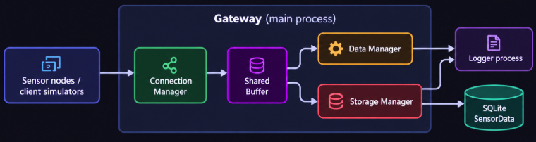

## 1. Project Overview

The gateway simulates a small IoT/embedded Linux system with five sensor types:

| Sensor | Type | Protocol | TCP Port |
|---|---:|---|---:|
| Temperature | 1 | TBP | `P` |
| Humidity | 2 | HLP | `P + 1` |
| Motion | 3 | EVP | `P + 2` |
| Door | 4 | EVP | `P + 2` |
| Smoke / Gas | 5 | SGP | `P + 3` |

For example, with base port `1234`:

- TBP: `1234`
- HLP: `1235`
- EVP: `1236`
- SGP: `1237`

The gateway converts all protocol-specific frames into a normalized `sensor_data_t` structure and distributes each measurement to two independent consumers:

- **Data Manager** — validation, running-average processing, event/state detection, and alarms.
- **Storage Manager** — persistent storage in SQLite.

---

## 2. System Architecture

The gateway consists of a main process with three manager threads.
Sensor simulators run as independent clients. Incoming sensor data is
normalized through the Connection Manager, distributed through the shared
buffer, processed by the Data Manager, and persisted by the Storage Manager.



### Data Flow

```text
Sensor Node
    ↓ TCP
Connection Manager
    ↓
Protocol Adapter
    ↓
sensor_data_t
    ↓
Thread-safe sbuffer
    ├──────────────→ Data Manager
    │                   ↓
    │              Validation / Alerts
    │
    └──────────────→ Storage Manager
                        ↓
                      SQLite
                        ↓
                    SensorData
```

---

## 3. Main Components

### Connection Manager

The Connection Manager:

- Opens four consecutive TCP listening ports.
- Uses `poll()` to handle multiple clients.
- Supports fragmented TCP frames.
- Supports multiple frames received in one TCP packet.
- Handles malformed frames without terminating the gateway.
- Converts protocol-specific messages into `sensor_data_t`.

Supported protocols:

- **TBP** — Temperature Binary Protocol
- **HLP** — Humidity Line Protocol
- **EVP** — Event Protocol for Motion and Door sensors
- **SGP** — Smoke/Gas Protocol with CRC-16 and ACK/NAK

---

### Shared Sensor Buffer

The shared buffer provides synchronization between producers and consumers.

Each measurement is consumed independently by:

1. Data Manager
2. Storage Manager

For storage reliability, the Storage Manager follows:

```text
peek measurement
      ↓
SQLite INSERT
      ↓
success?
 ├─ yes → commit storage read
 └─ no  → keep measurement buffered
```

This prevents a measurement from being discarded before successful persistence.

---

### Data Manager

The Data Manager loads sensor configuration from:

```text
config/room_sensor.conf
```

It validates:

- Sensor ID
- Sensor type
- Sensor-to-room configuration

Processing rules:

| Sensor | Processing |
|---|---|
| Temperature | Running average of last 5 samples |
| Humidity | Running average of last 5 samples |
| Motion | Log every detected motion event |
| Door | Log state transitions |
| Smoke / Gas | Immediate threshold comparison |

Default alarm thresholds:

| Condition | Threshold |
|---|---:|
| Temperature too cold | `< 15 °C` |
| Temperature too hot | `> 20 °C` |
| Humidity too dry | `< 30 %RH` |
| Humidity too humid | `> 70 %RH` |
| Smoke / Gas alarm | `>= 300 ppm` |

Alarm messages are emitted on state transitions rather than repeatedly for every sample.

---

### Storage Manager

The Storage Manager persists normalized measurements to SQLite.

Database:

```text
gateway.db
```

Schema:

```sql
CREATE TABLE SensorData (
    id INTEGER NOT NULL,
    type INTEGER NOT NULL,
    value REAL NOT NULL,
    ts INTEGER NOT NULL
);
```

The Storage Manager also supports database fault handling:

```text
INSERT failure
      ↓
mark SQL connection lost
      ↓
retain measurement in sbuffer
      ↓
reconnect / retry
      ↓
success → persist measurement
      ↓
or
      ↓
retry limit reached
      ↓
request internal gateway shutdown
```

---

### Logger Process

Logging is implemented as a separate process.

The gateway processes send log messages through a named FIFO, while the logger process writes them to:

```text
gateway.log
```

During shutdown:

- FIFO writer is closed.
- Logger receives EOF.
- Parent waits for the logger process.
- FIFO is removed.

---

## 4. Project Structure

```text
sensor-gateway/
├── config/
│   └── room_sensor.conf
│
├── include/
│   ├── connection_manager.h
│   ├── data_manager.h
│   ├── gateway.h
│   ├── logger.h
│   ├── sbuffer.h
│   ├── sensor_config.h
│   ├── storage_manager.h
│   └── ...
│
├── src/
│   ├── protocols/
│   │   └── protocol_adapters.c
│   │
│   ├── connection_manager.c
│   ├── data_manager.c
│   ├── gateway.c
│   ├── logger.c
│   ├── main.c
│   ├── sbuffer.c
│   └── storage_manager.c
│
├── test/
│   ├── run.sh
│   ├── test.py
│   └── test_protocols.c
│
├── tools/
│   └── sensor_node.c
│
├── runtime/
│   └── generated test logs
│
├── Makefile
└── README.md
```

> Build artifacts, runtime logs, FIFO files, and generated databases should normally be excluded using `.gitignore`.

---

## 5. Requirements

Developed and tested on Linux with:

- GCC
- GNU Make
- POSIX Threads (`pthread`)
- POSIX sockets
- `poll()`
- POSIX FIFO
- SQLite3
- Valgrind / Helgrind
- Python 3 for test traffic generation

Ubuntu dependencies:

```bash
sudo apt update

sudo apt install \
    build-essential \
    sqlite3 \
    libsqlite3-dev \
    valgrind \
    netcat-openbsd \
    python3
```

---

## 6. Build

### Release build

```bash
make
```

### Debug build

```bash
make debug
```

Debug mode enables diagnostic output through the `DEBUG` macro.

Build outputs:

```text
build/bin/server
build/bin/sensor_node
build/bin/test_protocols
```

---

## 7. Run the Gateway

Syntax:

```bash
./build/bin/server <base_port> <http_port>
```

Example:

```bash
./build/bin/server 1234 8080
```

Expected startup output:

```text
[CONN] Connection Manager started
[DATA] Data Manager started
[STOR] Storage Manager started
[CONN] TBP listening on TCP port 1234
[CONN] HLP listening on TCP port 1235
[CONN] EVP listening on TCP port 1236
[CONN] SGP listening on TCP port 1237
[DATA] Loaded 7 sensors from config/room_sensor.conf
[STOR] SQLite connected: gateway.db
[MAIN] Gateway started: base=1234 http=8080
```

Stop the gateway gracefully with:

```text
Ctrl+C
```

Expected shutdown:

```text
[MAIN] Shutdown requested by signal
[DATA] Data Manager stopped
[STOR] Storage Manager stopped
[CONN] Connection Manager stopped
[MAIN] Gateway stopped cleanly
```

---

## 8. Sensor Simulator

The included `sensor_node` tool can simulate sensor traffic.

### Temperature

```bash
./build/bin/sensor_node \
    temperature \
    10 \
    127.0.0.1 \
    1234 \
    1000
```

### Humidity

```bash
./build/bin/sensor_node \
    humidity \
    21 \
    127.0.0.1 \
    1234 \
    1000
```

### Motion

```bash
./build/bin/sensor_node \
    motion \
    30 \
    127.0.0.1 \
    1234 \
    1000
```

### Door

```bash
./build/bin/sensor_node \
    door \
    40 \
    127.0.0.1 \
    1234 \
    1000
```

### Smoke / Gas

```bash
./build/bin/sensor_node \
    smoke_gas \
    50 \
    127.0.0.1 \
    1234 \
    1000
```

The simulator selects the appropriate TCP port according to the sensor type.

---

## 9. Testing

### Full automated regression

```bash
make test
```

The regression covers:

- CRC-16 protocol test
- TBP parser
- HLP parser
- EVP Motion / Door parser
- SGP parser and ACK/NAK
- TCP fragmentation
- Multiple frames in one receive stream
- Corrupted / malformed frames
- Concurrent sensor clients
- Data Manager alarm transitions
- Unknown sensor ID
- Sensor type mismatch
- Clean gateway shutdown

Example result:

```text
All protocol tests passed.

M4 FUNCTIONAL TEST: PASS

M5 FUNCTIONAL TEST: PASS
```

---

## 10. SQLite Verification

List tables:

```bash
sqlite3 gateway.db ".tables"
```

Inspect schema:

```bash
sqlite3 gateway.db ".schema SensorData"
```

Count stored measurements:

```bash
sqlite3 gateway.db \
'SELECT COUNT(*) FROM SensorData;'
```

Inspect sensor distribution:

```bash
sqlite3 -header -column gateway.db \
'SELECT id, type, COUNT(*) AS samples
 FROM SensorData
 GROUP BY id, type
 ORDER BY id;'
```

---

## 11. Database Failure Recovery

The Storage Manager was verified with two failure scenarios.

### Temporary Database Lock

A sensor measurement is sent while SQLite is locked.

Expected behavior:

```text
Database locked
      ↓
INSERT failed
      ↓
SQL connection lost
      ↓
measurement remains buffered
      ↓
database lock released
      ↓
reconnect
      ↓
same measurement stored successfully
```

### Persistent Database Failure

If the database remains unavailable until the retry limit is reached:

```text
Connection to SQL server lost
      ↓
Reconnect attempts fail
      ↓
Unable to connect to SQL server
      ↓
Storage Manager requests shutdown
      ↓
Gateway performs controlled shutdown
```

The gateway exits without requiring an external signal.

---

## 12. Stress and Lifecycle Verification

The complete gateway was tested with all five sensor types running concurrently for several minutes.

Example test setup:

```text
Temperature : 200 ms
Humidity    : 250 ms
Motion      : 300 ms
Door        : 350 ms
Smoke / Gas : 400 ms
```

A three-minute integration run stored:

```text
3177 SensorData records
```

After shutdown:

- No gateway server process remained.
- TCP ports `1234`–`1237` were released.
- Worker threads terminated cleanly.
- SQLite was closed.
- Logger process terminated.
- Named FIFO was cleaned up.

---

## 13. Memory and Thread Verification

### Valgrind

```bash
valgrind \
    --leak-check=full \
    --show-leak-kinds=all \
    --track-origins=yes \
    ./build/bin/server 1234 8080
```

Final verification:

```text
in use at exit: 0 bytes in 0 blocks
ERROR SUMMARY: 0 errors from 0 contexts
```

### Helgrind

```bash
valgrind \
    --tool=helgrind \
    ./build/bin/server 1234 8080
```

Final verification:

```text
ERROR SUMMARY: 0 errors from 0 contexts
```

---

## 14. Implemented Midterm Milestones

| Milestone | Description | Status |
|---|---|---|
| M1 | Gateway lifecycle and worker threads | ✓ |
| M2 | Dedicated FIFO logger process | ✓ |
| M3 | Thread-safe shared sensor buffer | ✓ |
| M4 | TCP server and multi-protocol adapters | ✓ |
| M5 | Data Manager and sensor processing | ✓ |
| M6 | SQLite Storage Manager and fault recovery | ✓ |
| M7 | Integration, stress test, and controlled shutdown | ✓ |

### Midterm Status

```text
STEP 0 → STEP 7: COMPLETE
```

---

## 15. Key Embedded Linux Concepts Demonstrated

This project applies several Linux system-programming concepts in one integrated application:

- Processes and `fork()`
- POSIX threads
- Thread synchronization
- Condition variables
- TCP sockets
- `poll()`-based multiplexing
- Binary and text protocol parsing
- Named pipes / FIFO IPC
- Signals
- Graceful shutdown
- Shared producer-consumer buffering
- SQLite persistence
- Failure recovery
- Resource ownership and cleanup
- Valgrind memory verification
- Helgrind concurrency verification
- Makefile-based build automation

---

## 16. Current Scope and Future Work

This repository currently contains the **midterm core through Step 7**.

Potential next phases:

- POSIX shared memory for live gateway status
- Dedicated HTTP web process
- REST-style status/history/log endpoints
- Browser-based monitoring dashboard
- Additional system-health telemetry
- External data-platform integration

These features are intentionally separated from the current midterm submission.

---

## 17. Author

**Student:** `Truong Minh Thanh`  
**Course:** Embedded Linux  
**Project:** Sensor Gateway

"""